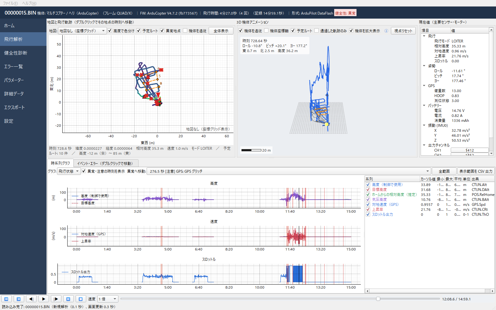

# Flight Log Analyzer（配布用）

ArduPilot の DataFlash ログ（`.bin`）と、JIYI フライトコントローラー（K++ 系）のログを読み込み、
**飛行軌跡・3D 再生・時系列グラフ・RC 入力・パラメーター・エラー一覧・自動健全性診断**を 1 つの画面で確認できる Windows 用のアプリです。

> 画面写真の位置情報は、公開用に緯度経度を (0°, 0°) 付近へ移動しています。

このリポジトリは配布専用です。ソースコードは含まれていません。

## ダウンロード

[Releases](https://github.com/ohara-aerojp/flight-log-analyzer-Releases/releases/latest) から最新版を入手してください。

| ファイル | 内容 |
|---|---|
| `FlightLogAnalyzer-x.y.z-setup.exe` | インストーラー（スタートメニューのショートカット・アンインストーラー付き） |

動作環境：Windows 10 / 11（64bit）。Python などの追加インストールは不要です。管理者権限なしでインストールできます。

> exe にはコード署名がないため、初回起動時に Windows SmartScreen の警告が出ることがあります。
> その場合は「詳細情報」→「実行」を押してください。

## 使い方

1. `FlightLogAnalyzer-x.y.z-setup.exe` を実行してインストールします（既定のインストール先：`%LOCALAPPDATA%\Programs\FlightLogAnalyzer`）。
2. スタートメニューから「Flight Log Analyzer」を起動します。
3. ホーム画面でログファイル（`.bin`）を選ぶか、ウィンドウにドラッグ＆ドロップします。
4. 形式は拡張子ではなくファイルの内容で自動判別され、解析と健全性診断が行われます。

### アップデート（0.2.2 以降）

起動時に新しいバージョンがあるか確認し、あれば変更点を表示します。「今すぐ更新」を押すと、インストーラーをダウンロードして SHA-256 を確かめたあと、アプリを閉じて更新し、自動で再起動します。
確認は「設定」画面でオフにできます。「ヘルプ」→「アップデートを確認」から手動でも確認できます。
0.2.1 以前をお使いの場合は、一度だけ 0.2.2 以降のインストーラーを手動で実行してください。

## 主な機能

| 画面 | 内容 |
|---|---|
| ホーム | ログを開く、最近の解析、形式判別の結果と根拠、飛行概要、健全性の総合評価 |
| 飛行解析 | 地図と飛行軌跡、3D 機体アニメーション、時系列グラフ、現在値、イベント一覧、RC 入力（スティック操作と軌跡、モード1／モード2 切替）。**すべて同じ時刻で同期して再生** |
| 健全性診断 | 振動・モーター出力・GPS・コンパス・バッテリー・IMU/温度・姿勢制御・ログ品質・エラーを **正常／注意／異常／判定不能** で評価。根拠・しきい値・信頼性を表示 |
| エラー一覧 | MSG / ERR / EV / MODE を時系列で一覧し、自動分類・重要度を表示 |
| パラメーター | 検索・並べ替え・CSV 出力、2 つのログの差分比較 |
| 詳細データ | 全メッセージ・全フィールドの生データ表 |
| エクスポート | PDF 解析レポート、CSV、地図/3D/グラフの画像 |

## 対応ログ形式

| 対象 | 対応状況 |
|---|---|
| ArduPilot DataFlash (.bin) | 正式対応 |
| JIYI K++ 系 (.bin) | 対応 |
| JIYI K3A Pro（MAVLink でダウンロードしたログ） | 実験的（実ログ未検証。読み込み時に警告） |
| ArduPilot テキストログ (.log)・テレメトリ (.tlog)・PX4 ULog | 未対応（理由を表示して中止） |

## データの扱い

- 元のログファイルは読み取り専用で開き、変更しません。
- ログを外部のサーバーへ送信しません。通信は地図タイル（国土地理院・OpenStreetMap）の取得と、GitHub への更新の確認・ダウンロードのみで、どちらも設定でオフにできます。
- 設定・解析履歴・キャッシュは `%LOCALAPPDATA%\FlightLogAnalyzer\` に保存します。更新やアンインストールでは削除されません。

## 注意事項

- 自動診断は点検の手がかりを示す支援機能です。「正常」は機体全体が完全に正常であることを保証するものではありません。
- JIYI ログの独自メッセージは意味が公開されていないため、「JIYI 固有・意味未確認」として表示します。
- 本ソフトは ArduPilot・JIYI の公式ソフトではありません。使用は自己責任でお願いします。

## 変更履歴

| 版 | 内容 |
|---|---|
| 0.2.2 | 起動時のアップデート確認と、アプリ内での更新を追加 |
| 0.2.1 | アプリのアイコンを Aero Japan のロゴに変更し、起動時に起動画面を表示 |
| 0.2.0 | 初の一般配布版。開発版 0.1.0 からの主な変更：3D 表示の機体モデルを実機形状に変更しプロペラ回転を追加、3D 表示の背景を暗く変更、飛行解析画面に RC 入力タブを追加、3D 表示にスケールバーと位置・高度の出典表示を追加 |
